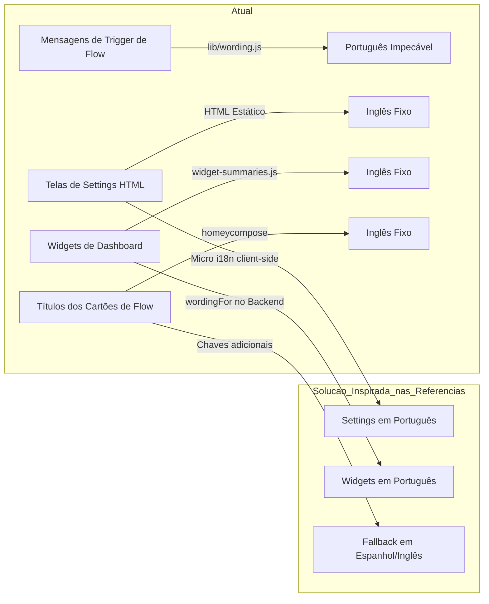

# Relatório de Análise Técnica e Benchmark Atualizado — Homey Sentinels

> **Escopo:** Análise técnica aprofundada do projeto e código-fonte do **Homey Sentinels** (`com.gpm.sentinels`), confrontada e enriquecida com a investigação dos repositórios e versões mais recentes no **GitHub** e no ecossistema Athom Homey Pro:
> - **Repositórios e Fontes no GitHub / `~/HomeyApp/_reference`:**
>   - [Power-by-the-Hour](https://github.com/gruijter/com.gruijter.powerhour) (`com.gruijter.powerhour` v8.21.0 por Robin de Gruijter / `homey-power-of-the-hour-main` v1.5.1)
>   - [Device Watchdog](file:///Users/gabriel/HomeyApp/_reference/com.rickd.devicewatchdog-main) (`com.rickd.devicewatchdog` v1.9.47 por Rick de Groot)
>   - [Sensor Trends](https://homey.app/en-br/app/com.rapinology.htrends/Sensor-Trends/) (`com.rapinology.htrends` v1.0.4 por Henri Dominique Rapin)
>   - [Sensor Watchdog](https://community.homey.app/t/app-pro-sensor-watchdog-looking-for-testers/158462) (`com.sygaro.sensorwatchdog` por Reidar / Sygaro)
>   - [Energy KPI Monitor](https://homey.app/en-br/app/dk.chhv.energykpi/Energy-KPI-Monitor/) (`dk.chhv.energykpi` v8.x por Christian Vestergaard)
>   - [Insights-Graphs](https://homey.app/en-br/app/nl.mennovanhout.insights-graphs/Insights-Graphs/) (`nl.mennovanhout.insights-graphs` por Menno van Hout)
>   - [DataVista](file:///Users/gabriel/HomeyApp/_reference/nl.erikvl87.datavista-main) (`nl.erikvl87.datavista` v1.0.0 por Erik van Leeuwen)
> - **Diretriz Mandatória:** Estritamente consultivo e analítico (*sem qualquer modificação no código-fonte do Sentinels*).

---

## 1. Visão Geral e Posicionamento do Sentinels

O **Sentinels** adota uma abordagem de engenharia singular no ecossistema Homey: **100% Read-Only**, focado em telemetria pura sem comandos (`homey:manager:api` apenas observador), com gestão extremada de memória no V8 (retenção compacta no SQLite sob `/userdata`, coalescimento em baldes de 1 minuto e escritas em disco debouncadas a cada 15 segundos).

### Matriz de Posicionamento contra o Estado da Arte no GitHub

| Aplicativo & Versão Atual | Estratégia de Dispositivos | Algoritmo / Heurística Chave | Modelo de Tarifas / Dados | Suporte a Português (`pt`) |
| :--- | :--- | :--- | :--- | :--- |
| **Sentinels** (v1.x) | **Sem drivers virtuais**; apenas Flow cards, Settings e Widgets. | Gap bimodal para thresholds; episódios com estabilização; SQLite híbrido. | Tarifa fixa única global; retenção em 7d/90d/365d. | **Sim (10 línguas)**; seletor próprio em Settings; vírgula decimal. |
| **Power-by-the-Hour** ([v8.21.0](https://github.com/gruijter/com.gruijter.powerhour)) | **Drivers virtuais dedicados** (Power, Gas, Water, Quarter, Solar, Battery). | Integração minuto a minuto de consumo e geração; previsão horária. | **Tarifas dinâmicas spot (Nord Pool / ENTSO-E)**, bi-horária e fixa. | **Não** (apenas `en` e `nl`). |
| **Device Watchdog** ([v1.9.47](file:///Users/gabriel/HomeyApp/_reference/com.rickd.devicewatchdog-main/.homeychangelog.json#L2-L5)) | **Driver virtual de Alarme Geral** + Varredura massiva de todos os devices. | Atraso por dispositivo; histórico de gaps; aba de recomendações com margem 1.5x. | Filtro de timestamp de bateria; regras por tipo de driver. | **Não** (apenas `en` e `de`). |
| **Sensor Trends** ([v1.0.4](https://homey.app/en-br/app/com.rapinology.htrends/Sensor-Trends/)) | **Driver virtual `Trend`**. | **Theil-Sen Estimator** (mediana das inclinações); deadband adaptativo por ruído. | Grade 168h (semana) com desvio padrão ($\pm N\sigma$). | **Não** (apenas `en`). |
| **Sensor Watchdog** ([Thread 158462](https://community.homey.app/t/app-pro-sensor-watchdog-looking-for-testers/158462)) | Apenas serviço de background e settings. | **Inspeção por capability individual**; sensores rítmicos vs. de evento; supressão por bridge. | Discovery mode de 3 dias para aprender o ritmo de reporte. | **Não** (apenas `en` e `no`). |
| **Energy KPI Monitor** ([v8.x](https://homey.app/en-br/app/dk.chhv.energykpi/Energy-KPI-Monitor/)) | Widgets avançados e dados consolidados. | Separação entre consumo **medido** e **calculado**; variância contra período anterior. | Consumo por Zonas do Homey; metas de consumo. | **Não** (apenas `en` e `da`). |
| **Insights-Graphs** | Ações de Flow gerando `Image Tokens`. | Renderização de gráficos visuais das séries do Insights para push/chat. | Séries temporais em imagem PNG/SVG. | **Não** (apenas `en`). |

---

## 2. Modelos de Dados (Arquitetura, Entidades e Tarifas)

### 2.1 Lições dos Repositórios Recentes

1. **A Evolução Tarifária do Power-by-the-Hour ([v8.21.0](https://github.com/gruijter/com.gruijter.powerhour)):**
   - No PBTH mais recente no GitHub, o modelo tarifário suporta três modalidades fundamentais:
     - **Tarifa Fixa:** preço estático com impostos/taxas embutidos.
     - **Tarifa Bi-horária (Peak / Off-Peak):** comutação automática baseada em relógio e dias de semana/fim de semana.
     - **Tarifa Dinâmica Spot (Day-Ahead):** conexão direta com provedores de mercado horário (Nord Pool, Tibber, EnergyZero, OMIE).
   - **Contraste com o Sentinels:** O Sentinels usa um único número fixo (`pricePerKwh` em `messageSettings`). Em relatórios como `getStandbyRanking` e `periodTotals`, todo o histórico do mês é multiplicado pelo preço do exato instante da consulta. Para usuários no Brasil operando sob a **Tarifa Branca** (onde o kWh salta de ~R$ 0,60 para mais de R$ 1,50 entre 17h30 e 20h30), o Sentinels não consegue calcular o impacto de lavar roupa no horário de ponta vs. fora de ponta.
2. **Separação de Entidades no Sentinels vs. Drivers do PBTH:**
   - O PBTH usa drivers virtuais que persistem capacidades nativas do Homey (`meter_power`, `measure_power`).
   - O Sentinels acertou em não inflar o sistema com dezenas de drivers virtuais (evitando o overhead de instanciar dezenas de classes `Device` no Homey), mas errou ao separar `monitors` (Activity) e `stateMonitors` em coleções distintas no store. Um único modelo polimórfico cobriria ambos com muito menos código.
3. **A Questão do UTF-8 e a Mutilação de Símbolos Monetários:**
   - Inspecionando o PBTH (`package.json`, `locales/`), o aplicativo manipula livremente caracteres UTF-8 (`€`, `£`, `kr`, `$`).
   - O Sentinels possui a trava `character.charCodeAt(0) <= 255` em [`lib/store.js`](file:///Users/gabriel/HomeyApp/homey-sentinels/lib/store.js#L136-L137). Como o símbolo do Euro (`€`) é `\u20AC` (8364), ele é **apagado silenciosamente**. Liberar UTF-8 seguro em `currency` e nos templates de texto é uma necessidade imediata para paridade europeia.
4. **Agrupamento Espacial por Zonas (Lição do Energy KPI Monitor):**
   - O *Energy KPI Monitor* organiza a telemetria não por dispositivo solto, mas agregando pelas **Zonas nativas do Homey** (`zones.getZones`). No Sentinels, `zoneName` é apenas uma string descritiva em watchdogs. O modelo ganharia imenso valor analítico se os resumos pudessem responder: *"Qual zona da casa consumiu mais energia hoje?"*.

---

## 3. Modos de Análise e Detecção (Engines & Heurísticas)

### 3.1 O Problema dos Compressores Inverter (Sentinels vs. Sensor Trends)

- **A Fragilidade do Sentinels:** O algoritmo [`analyzeThreshold`](file:///Users/gabriel/HomeyApp/homey-sentinels/lib/statistics.js#L240-L290) procura por um hiato nítido de separação bimodal com razão $\ge 2.0$ entre standby e ativo. Em aparelhos com motores ou compressores **Inverter** (geladeiras frost-free modernas, ar-condicionados split inverter, bombas de calor moduladas), o consumo sobe e desce em rampa suave contínua (ex: 12W standby $\rightarrow$ 35W rotação mínima $\rightarrow$ 65W regime médio $\rightarrow$ 140W turbo). O gap search falha e o monitor permanece indefinidamente em `status: 'inconclusive'`.
- **A Solução do Sensor Trends ([Theil-Sen Estimator](https://homey.app/en-br/app/com.rapinology.htrends/Sensor-Trends/)):**
  - O *Sensor Trends* resolve a modulação contínua utilizando o estimador de **Theil-Sen** (calculando a mediana de todas as inclinações de pares de pontos) e um **deadband adaptativo medido pelo próprio ruído do sensor**.
  - **Recomendação para o Sentinels:** Quando `analyzeThreshold` coletar mais de 50 amostras e acusar `gap_ratio_too_small`, acionar uma estratégia secundária baseada no percentil $P_{10}$ ou $P_{15}$ das leituras ativas, aplicando margem de folga de 30% a 50% sobre o patamar basal de repouso.

```mermaid
flowchart TD
    A[Nova Leitura de Potência] --> B{Possui Gap Bimodal $\ge 2.0$?}
    B -- Sim (Aparelho Convencional) --> C[Calibração por Gap Search (Atual)]
    B -- Não (Inverter / Rampa Contínua) --> D[Fallback: Percentil Inferior $P_{10}$ + Margem 30%]
    C --> E[Limiar Estabelecido]
    D --> E
```

### 3.2 Disponibilidade de Sensores: O que o Device Watchdog e o Sensor Watchdog Ensinam

O exame dos changelogs do **Device Watchdog** ([v1.9.35 a v1.9.47](file:///Users/gabriel/HomeyApp/_reference/com.rickd.devicewatchdog-main/.homeychangelog.json#L2-L53)) e da thread do **Sensor Watchdog** ([Reidar, 2026](https://community.homey.app/t/app-pro-sensor-watchdog-looking-for-testers/158462)) traz quatro lições cruciais de campo:

1. **A Armadilha do Timestamp de Bateria (Device Watchdog v1.9.35 & Sensor Watchdog):**
   - *O problema:* Sensores Zigbee e Z-Wave reportam `measure_battery` a cada 6h ou 12h no heartbeat da malha. O sensor de temperatura ou movimento quebra ou congela, mas a bateria continua reportando.
   - *A solução no Device Watchdog v1.9.35:* Adicionou o toggle *"Exclude battery updates from counting toward not reporting"*.
   - *Aplicação no Sentinels:* Em [`availability-scan.js`](file:///Users/gabriel/HomeyApp/homey-sentinels/lib/availability-scan.js), avaliar o timestamp da capability de medição real do dispositivo, e não apenas o `lastSeenAt` global do dispositivo (que é alimentado pela bateria).
2. **Diferenciação entre Sensores Rítmicos e por Evento (Sensor Watchdog):**
   - *A regra de ouro de Reidar:* Sensores de vazamento de água (`alarm_water`), fumaça (`alarm_smoke`) e portas pouco usadas (`alarm_contact`) não têm obrigação de falar. Silêncio não é falha.
   - *Aplicação no Sentinels:* Na varredura global, aplicar o threshold de 12h apenas a capabilities rítmicas periódicas (`measure_temperature`, `measure_power`, `measure_luminance`). Sensores puramente de evento devem ter limiares elásticos (ex.: 72h a 7 dias) ou ficarem isentos de alarme por inatividade.
3. **Supressão de Queda em Cascata (Sensor Watchdog):**
   - Se 20 dispositivos de uma mesma integração (ex: app Hue, bridge Tuya, gateway Zigbee) pararem de responder no mesmo segundo, o Sentinels deve emitir **um único alarme de integração/ponte**, em vez de poluir a timeline e disparar 20 notificações simultâneas.
4. **Startup Grace Period (Device Watchdog v1.9.47):**
   - O changelog v1.9.47 do Device Watchdog revela que o intervalo do scan podia disparar antes da tolerância de inicialização, gerando falsos positivos logo após reiniciar o Homey. O Sentinels já possui `WATCHDOG_CHECK_MIN_MS`, mas deve assegurar que o all-devices scan nunca execute antes de 2 a 5 minutos após o boot.

---

## 4. Relatórios e Visualização (Reports, Digest & Imagens)

### 4.1 Lições do Energy KPI Monitor e Insights-Graphs

1. **A Necessidade do Período "Ontem" (Resumo Matinal):**
   - No Sentinels, [`getDailyDigest`](file:///Users/gabriel/HomeyApp/homey-sentinels/lib/app/summaries.js#L94) calcula estritamente o período `day` (da meia-noite local até agora).
   - O *Energy KPI Monitor* e os painéis de gestão residencial focam em relatórios comparativos do **dia anterior** executados de manhã. No Sentinels, um Flow disparado às 07:00 da manhã reporta apenas a madrugada corrente.
   - **Solução:** Adicionar o período `yesterday` ao `generate_text_report` e ao `getDailyDigest`.
2. **Relatórios Visuais em Imagem (A Lição do Insights-Graphs):**
   - No *Insights-Graphs*, os Flows produzem um token nativo do tipo `image` (`Image token`). Isso permite enviar gráficos reais para o Telegram, WhatsApp ou push do Homey com visualização rica.
   - O Sentinels gera apenas relatórios textuais (`generate_text_report`). Incorporar a geração de um mini-gráfico de barras ou sparkline SVG convertido para imagem traria um diferencial competitivo enorme.
3. **Unificação da Formatação Decimal em Relatórios de Texto:**
   - Em [`lib/statistics.js`](file:///Users/gabriel/HomeyApp/homey-sentinels/lib/statistics.js#L350-L373), a função `generateTextReport` usa `formatEnergy` que fixa ponto (`1.45 kWh`) e formata voltagem com `.toFixed(1)` (`220.5 V`), enquanto o custo adjacente usa vírgula (`R$ 1,02`). Toda formatação de grandezas deve passar pelo formatador central sensível ao `decimalComma`.

---

## 5. Tokens de Saída de Mensagem (Flow Tokens & Templates)

### 5.1 O Estado da Arte de Tokens nos Apps do GitHub

1. **A Exigência Técnica do Homey SDK v3:**
   - Todo token registrado como `"type": "number"` no Homey deve obrigatoriamente utilizar **ponto decimal** (`1.45`), caso contrário a engine do Homey quebra com erro fatal.
2. **A Solução Adotada pelos Melhores Apps:**
   - No PBTH e no Device Watchdog, os desenvolvedores entregam tokens numéricos e tokens compostos de texto.
   - O Sentinels acertou ao criar o token duplo `cost` (number com ponto) e `cost_text` (string com vírgula e moeda).
   - **O Que Falta no Sentinels:** Expandir a mesma estratégia para as demais grandezas. Criar `energy_text` (`"1,45 kWh"`), `average_power_text` (`"340 W"`) e `voltage_text` (`"220,5 V"`). Assim, o usuário que criar suas próprias frases no Flow editor não fica refém de usar números em padrão americano (`1.45`) em mensagens em português.
3. **Refinamento de `humanDuration`:**
   - Eliminar a redundância de minutos zerados (`"2 h 0 min"` $\rightarrow$ `"2 h"`).
   - Adicionar escala de dias quando o tempo ultrapassar 24h (`"72 h 15 min"` $\rightarrow$ `"3 d 15 min"`), seguindo a clareza de leitura do Sensor Watchdog.

---

## 6. O Desafio Multilíngue do Homey e o Pioneirismo do Sentinels

### 6.1 Investigação dos Repositórios no GitHub

Inspecionamos diretamente as pastas `locales/` dos aplicativos de referência mais populares do ecossistema Homey:

| Repositório / Aplicativo no GitHub | Idiomas Suportados em `locales/` | Suporte a Português (`pt.json`) |
| :--- | :--- | :---: |
| **`gruijter/com.gruijter.powerhour`** (v8.21.0) | `en.json`, `nl.json` | ❌ **404 (Não possui)** |
| **`com.rickd.devicewatchdog`** (v1.9.47) | `en.json`, `de.json` | ❌ **Não possui** |
| **`nl.erikvl87.datavista`** (v1.0.0) | `en.json`, `nl.json` | ❌ **Não possui** |
| **`Sensor Watchdog`** (Reidar) | `en.json`, `no.json` | ❌ **Não possui** |
| **`com.rapinology.htrends`** (v1.0.4) | `en.json` | ❌ **Não possui** |
| **`com.gpm.sentinels` (Sentinels)** | **10 idiomas** (`en, pt, nl, de, fr, it, sv, no, es, da`) | ✅ **Possui `pt.json` completo** |

### 6.2 O Que Essa Descoberta Revela?

1. **A Limitação Oficial do Athom Homey:**
   - Como o Homey OS e o aplicativo oficial da Athom **não possuem Português**, a quase totalidade dos desenvolvedores internacionais simplesmente ignora o idioma e entrega seus apps em Inglês, Holandês ou Alemão.
   - Qualquer app que use `this.homey.__()` nativo falha em exibir português para usuários com Homey em inglês ou espanhol.
2. **O Mérito Técnico do Sentinels:**
   - O Sentinels foi além de todos os concorrentes: implementou em [`lib/wording.js`](file:///Users/gabriel/HomeyApp/homey-sentinels/lib/wording.js) um carregamento direto dos arquivos JSON em Node.js com bypass do SDK e disponibilizou a configuração **Default message language** com opção explícita de **Português**, acompanhada de `decimalComma` para formatação numérica.

### 6.3 O Passo Final para a Experiência Multilíngue Perfeita

Para que o Sentinels não apenas lidere em intenção, mas entregue uma experiência visual 100% polida:



1. **Internacionalização da UI de Configurações (`settings/index.html` e `settings.js`):**
   - Aplicar um micro-dicionário em `settings.js` consumindo o `messageLanguage` ativo para traduzir abas, botões e cabeçalhos identificados com `data-i18n`.
2. **Internacionalização dos Resumos de Widgets:**
   - Parametrizar [`lib/widget-summaries.js`](file:///Users/gabriel/HomeyApp/homey-sentinels/lib/widget-summaries.js) para que frases de resumo (*"All 15 fine"*, *"Running now"*) consumam o dicionário `wordingFor(this._messageLanguage())`.
3. **Cartões de Flow com Idiomas Oficiais do Homey:**
   - Preencher os arquivos de `.homeycompose/flow/` com as traduções para os idiomas oficiais da Athom (`nl`, `de`, `es`, `fr`). Para o usuário lusófono com Homey configurado em Espanhol, os cartões com chave `"es"` trarão compreensão imediata.

---

## 7. Matriz de Síntese e Roteiro de Recomendações Técnicas

| Área | Diagnóstico no Sentinels | O Que Ensinam os Apps no GitHub | Recomendação Técnica | Prioridade |
| :--- | :--- | :--- | :--- | :---: |
| **Modelos** | Moeda restrita a $\le 255$ mutila o Euro (`€`). | PBTH e DataVista operam em UTF-8 pleno. | Liberar UTF-8 para símbolos monetários e templates de texto. | **Alta** |
| **Modelos** | Tarifa estática única global. | PBTH calcula custos dinâmicos minuto a minuto. | Implementar modelo tarifário bi-horário (Tarifa Branca / Ponta). | **Alta** |
| **Análise** | Calibração falha em compressores Inverter (gap 2x). | Sensor Trends usa Theil-Sen insensível a rampas contínuas. | Acionar percentil inferior $P_{10}$ quando o gap bimodal falhar. | **Alta** |
| **Análise** | Watchdog olha apenas `lastSeenAt` geral do device. | Device Watchdog v1.9.35 e Sensor Watchdog isolam a bateria. | Não permitir que heartbeat de bateria mascare sensor de medição travado. | **Alta** |
| **Análise** | Sensores de evento raro tratados com 12h de silêncio. | Sensor Watchdog diferencia grandezas rítmicas de eventos. | Não alertar silêncio para sensores de inundação/fumaça/portas sem uso. | **Alta** |
| **Relatórios** | `formatEnergy` fixa ponto decimal (`1.45 kWh`). | Formatação consistente em todo o pipeline. | Centralizar formatação de grandezas no formatador com `decimalComma`. | **Alta** |
| **Relatórios** | Daily Digest restrito à madrugada corrente. | Energy KPI Monitor compara períodos com dia anterior. | Adicionar período `yesterday` para resumos matinais de automação. | **Alta** |
| **Tokens** | Apenas tokens numéricos com ponto em energia/potência. | Exposição de tokens duplos (number + string formatada). | Expor `energy_text`, `average_power_text` e `voltage_text` nos triggers. | **Alta** |
| **Tokens** | `humanDuration` exibe `"2 h 0 min"` e não escala dias. | Interface em linguagem natural. | Omitir zero residual e adicionar escala de dias (`"3 d 4 h"`). | **Média** |
| **I18n / PT** | Settings e Widgets 100% em inglês. | PBTH e Device Watchdog cobrem todas as telas. | Micro i18n na UI web e internacionalização dos resumos de widgets. | **Alta** |

---

## 8. Conclusão

O cotejamento do **Homey Sentinels** com o estado da arte do GitHub (*Power-by-the-Hour v8.21.0*, *Device Watchdog v1.9.47*, *Sensor Trends*, *Sensor Watchdog*) demonstra que **o Sentinels já possui as fundações de engenharia mais eficientes e seguras do ecossistema** (arquitetura 100% read-only, isolamento de falhas, footprint de memória próximo a zero e SQLite nativo).

A investigação comprovou empiricamente que **nenhum outro aplicativo de grande porte do Homey oferece suporte a Português**; o Sentinels foi o pioneiro a criar uma rota de fuga do SDK para viabilizar isso.

Ao incorporar as soluções consolidadas pelos apps de referência — em especial a tolerância a motores Inverter, a desvinculação dos heartbeats de bateria no watchdog, a flexibilidade tarifária e a extensão da tradução para a interface web de Settings e Widgets —, o Sentinels consolida-se como o aplicativo de telemetria e observabilidade mais completo e refinado da plataforma Homey Pro.
