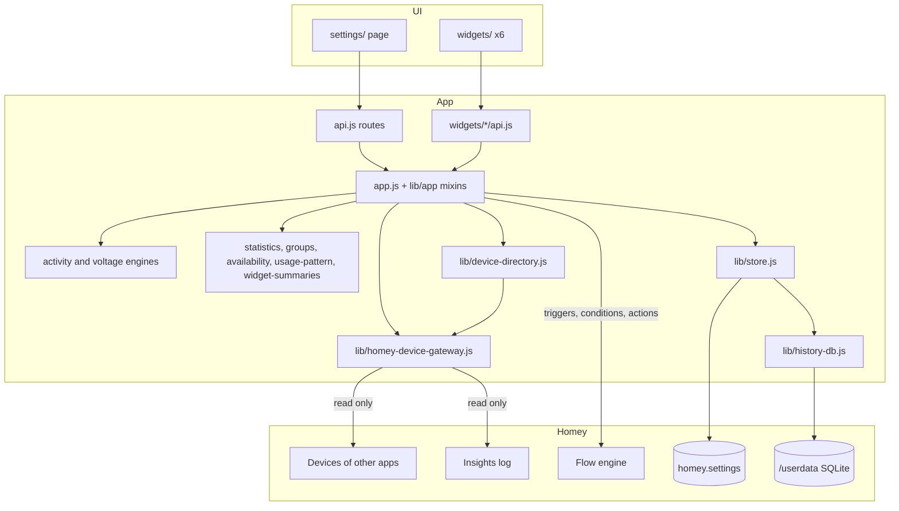
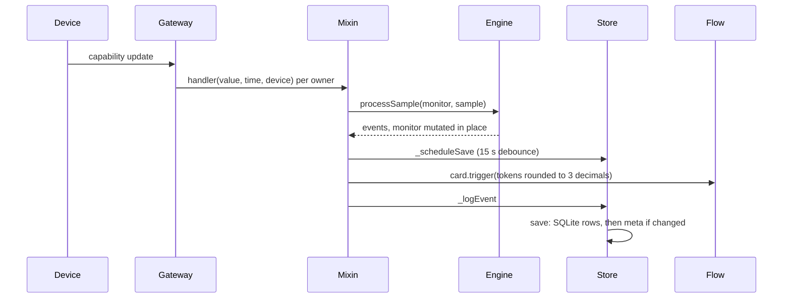

# Codebase Map

> Auto-generated by Cartographer. Last mapped: 2026-11-08T12:26:12Z

Sentinels (`com.gpm.sentinels`, version 1.0.10) is a Homey Pro SDK3 app that only observes. It watches other apps' devices and reports through Flow cards, a Settings page and six dashboard widgets. It never sends a device command. It has no drivers and no virtual devices.

It runs on the Homey's own Node (22 today, which provides `node:sqlite`), not on the development machine's Node. There is no compile step. CI uses Node 22.

## System Overview



## Directory Structure

```
.homeycompose/    Source of the manifest: app.json (44 API routes) and flow/ (44 cards)
app.json          GENERATED from .homeycompose. Never edit by hand
app.js            App class: state, startup, scheduling, event log, time zone
api.js            Settings page routes (route handlers calling homey.app.*)
lib/              Pure or near-pure logic, no `this`
lib/app/          Mixins copied onto the App prototype, `this` is the app
settings/         Settings page (one HTML, one JS closure, one CSS)
widgets/          availability, health, overview, sentinel, timeline, voltage
locales/          App's own message wording, 10 languages, same 65 keys each
test/             node:test suite; settings-harness/ runs Settings in jsdom
scripts/          write-build-info.js, install-git-hooks.js
SPEC.md           Technical spec            CONTRIBUTING.md  Rules and recipes
HOWTO.md          User guide                TUTORIAL.md      Worked examples
TODO.md           Log, pending, decided-against list
```

## Module Guide

Token counts are from the scanner.

### App core

**Purpose**: owns the store, engines, gateway and cards, and mixes in behaviour.
**Entry point**: `app.js`, class `StatisticTrackerApp`, mixins assigned at the end of the file.

| File | Purpose | Tokens |
|------|---------|--------|
| `app.js` | Startup, `_scheduleWithBackoff`, `_scheduleSave`, `inAppContext`, `_logEvent`, time zone | 3733 |
| `api.js` | Settings routes; looks items up, calls the app, saves | 3411 |

### Mixins: `lib/app/`

**Dependencies**: `lib/*`. Nothing in `lib/` imports from `lib/app/`.
**Dependents**: the App class. `api.js` calls several underscore methods, so treat those as public.

| File | Purpose | Tokens |
|------|---------|--------|
| `activity.js` | Power monitor runtime, auto calibration, Insights seed and rebuild | 3249 |
| `state.js` | State monitor runtime | 1029 |
| `voltage.js` | Voltage monitor runtime | 1029 |
| `groups.js` | Live group watch, 5 min poll, missing members | 2646 |
| `availability-watchdogs.js` | Per-device watchdogs, 10 min poll | 1887 |
| `availability-scan.js` | All-device scan, announcements, exclusions | 1502 |
| `monitor-admin.js` | Create, resume, remove, reset, move monitors; `_say` | 4280 |
| `flow-cards.js` | Registers cards, autocompletes, `withLogging` | 5818 |
| `summaries.js` | `_cached`, widget and Settings summaries, thin delegates | 3974 |
| `housekeeping.js` | Startup summary, history consolidation | 565 |
| `constants.js` | Intervals, limits, `num`, `roundTokens`, `formatEnergy` | 1461 |

### Domain logic: `lib/`

| File | Purpose | Tokens |
|------|---------|--------|
| `activity-engine.js` | ACTIVE/STANDBY state machine, periods, cycles; used for activity, state and manual | 4743 |
| `voltage-engine.js` | NORMAL/UNDER/OVER episodes | 2563 |
| `statistics.js` | Statistics, trend, threshold analysis, text report | 6860 |
| `groups.js` | `GROUP_TYPES`, judging, group statistics | 1495 |
| `availability.js` | Watchdog verdict, settings normalisation, `isNotFoundError` | 1482 |
| `availability-scan.js` | Pure all-device judging | 836 |
| `usage-pattern.js` | 7x24 grid from cycles | 2465 |
| `insights-replay.js` | Rebuilds history by replaying Insights through the real engine | 1030 |
| `widget-summaries.js` | Pure widget data shaping | 1971 |
| `message-template.js` | `%x%` and `%count:a\|b%`, decimal comma (module-level flag) | 610 |
| `wording.js` | Loads `locales/*.json` directly, resolves language | 621 |
| `time.js` | Local-time helpers on `Intl` | 728 |
| `text.js` | `punctuationToAscii` | 268 |
| `resume.js` | `resumeWithRetry` | 610 |

### Persistence and Homey access

| File | Purpose | Tokens |
|------|---------|--------|
| `lib/store.js` | `SentinelStore`: the state; methods are mixed in from `lib/store/` | small |
| `lib/store/persistence.js` | `load`, `save`, settings keys, incremental series writes | ~3400 |
| `lib/store/activity-monitors.js`, `state-monitors.js`, `voltage-monitors.js`, `groups.js`, `availability.js` | CRUD and validation per kind | ~6500 |
| `lib/store/migrations.js` | Idempotent backfills of older saved data | ~1400 |
| `lib/store/retention.js` | Folding old detail, `consolidateHistory` | ~2200 |
| `lib/store/common.js` | Starting values, identity changes, shared validation | ~900 |
| `lib/history-db.js` | `node:sqlite` wrapper; returns `null` on failure, quarantines corrupt files | 1428 |
| `lib/storage-format.js` | Tuple encoding of rows, lossless fallback to objects | 1053 |
| `lib/homey-device-gateway.js` | Read-only `homey-api` wrapper, shared capability instances with owner fan-out | 2573 |
| `lib/device-directory.js` | On-demand slim device list | 743 |

### Settings page: `settings/`

| File | Purpose | Tokens |
|------|---------|--------|
| `index.html` | Tabs Monitors (Activity, State, Voltage), Availability, Groups; modals | 7791 |
| `settings.js` | Entry point: builds `page`, calls each setup, `loadAll` and the 60 s refresh | ~1800 |
| `ui.js` | Stateless helpers (formatting, rows, modals), global functions | ~2100 |
| `messages.js` | Live previews, token buttons, Fill default wording, Message format | ~3000 |
| `groups.js` | Groups tab | ~4000 |
| `monitors.js`, `monitor-forms.js`, `usage-pattern.js` | Monitor lists, their forms, standby and pattern views | ~7500 |
| `device-picker.js` | Capability, zone, device pickers | ~2500 |
| `availability.js` | Availability tab | ~5500 |
| `style.css` | Light and dark tokens; `.container` + `!important` overrides | 5738 |

Scripts are plain ES5 loaded in order from `index.html`. Each part is a `setupX(page)`; `page` holds `api`, the two changing values (`monitorPeriod`, `allDevices`) and what parts export for one another, and the order of the setup calls matters. The UI text is intentionally English-only. The device list is request-then-poll: `GET /devices` returns the cache, then the page polls `/devices/status`.

### Widgets: `widgets/`

Each has `api.js`, `widget.compose.json`, `public/index.html`, and light and dark previews. Pages poll every 30 s and call `homey.app.*` through their `api.js`.

| Widget | Shows | App method |
|--------|-------|------------|
| `sentinel` | One monitor or group, with period buttons | `getWidgetSummary` |
| `overview` | Up to 5 picked items, or all | `getWidgetSummary`, `getWidgetList` |
| `availability` | Watchdogs, tiles, Check now | `getWatchdogsWidgetSummary`, `checkWatchdogsNow` |
| `health` | Overall status rows | `getHealthWidgetSummary` |
| `voltage` | Voltage per monitor | `getVoltageWidgetSummary` |
| `timeline` | Recent events | `getRecentEvents(50)` |

### Flow cards: `.homeycompose/flow/`

44 cards: 18 triggers, 10 conditions, 16 actions. They are handled in `lib/app/flow-cards.js` and `lib/app/groups.js`; triggers are obtained in `app.js`. Cards that return tokens appear only in Advanced Flow.

### Tests: `test/`

`npm test` runs `node --test`. No shared Homey mock exists: each test builds the smallest stand-in, with mixins assigned onto a fake app and a hand-written gateway (`groups-live.test.js` is the reference).

Structural guards:
- `app-structure.test.js`: every `this.x()` and `homey.app.x()` exists, no method is defined twice, and routes reaching `this.gateway` use `inAppContext`.
- `wording.test.js`: all languages have all sentences, and no character is above U+00FF.
- `settings-page.test.js`: replays `settings-harness/trace.js` in jsdom against hashed snapshots.

No direct test: `lib/app/flow-cards.js`, `state.js`, `voltage.js`, `availability-watchdogs.js`, the widgets, and real device I/O. Check those with `homey app run -r`.

## Data Flow

### Startup (`onInit`)

Opens the SQLite file, loads the store, builds engines, gateway and directory, and registers cards and widgets before any network work. Then, in the background: time zone refresh, history consolidation (now and every 6 h), group polling (5 min), watchdogs and the scan after the startup grace, then monitor resume and group watches.

### Capability event



Reads (API and widgets) go through `_cached` (5 s and `store.revision`) and pure functions over the in-memory `store.data`.

### Persistence

| Where | What |
|-------|------|
| `homey.settings` `sentinels:v3` | Everything except `periods` and `cycles` |
| `homey.settings` `sentinels:v2` | Fallback with no database: meta and tuple-encoded series in one key |
| `/userdata/sentinels-<random>.sqlite` | Table `series(monitor, tag, idx, row)`; tags `p` and `c` |
| Memory only | Device list, scan problems, group live values, calibration maps, summary cache |

Retention: granular periods 7 days, daily summaries 90 days, cycles 365 days, voltage events 90 days, event log latest 50. `totals.cycleCount` is lifetime.

## Conventions

- Keep new logic in a pure function in `lib/` with explicit `now` and `timeZone`, and test it. Keep Homey glue in `lib/app/`.
- Use `this.homey.setTimeout` for timers and `_scheduleWithBackoff` for polled network jobs.
- Comments explain why, often citing a real incident.
- No new dependencies: `homey-api` is the only runtime one.
- One topic per commit, with a message that says why. Release with `homey app version`, `homey app publish`, then an annotated tag.

## Gotchas

**Rules that exist because something broke**
- Read-only: never add a device command or a write to Homey.
- A route must not call the Homey API on its own stack, or the call may never resolve. Wrap it in `homey.app.inAppContext`.
- `homey.settings.set` reserialises everything, so keep settings small. One character above U+00FF doubles the memory of each write, so default text stays ASCII or Latin-1.
- Do not read the full device list casually: use `DeviceDirectory`, or `gateway.getDevice(id)` for one device.
- Inside the real Homey app, Homey's CSS lands on top of the page. Settings buttons, inputs and headings need `.container` scope and `!important`, and a normal browser will not show the problem.
- `.homeychangelog.json` text must have no double quotes or apostrophes, because the CLI builds a shell command from it.
- Wording does not go through Homey's `__()`. All 10 `locales/*.json` must keep the same keys.
- `homey.clock` has been seen reporting UTC. Use `_getTimezone()`.

**Behaviour that surprises**
- Engines mutate the monitor in place and return events; only the mixins do timers and I/O.
- An extra field on a period or cycle silently stops tuple encoding for that row. Update `SCHEMAS` in `lib/storage-format.js`.
- A gap over 4 h between samples is discarded.
- Entering a voltage excursion fires at once; only the return waits for the stabilization window.
- `mismatchSince` makes group triggers fire once per transition. Check-type cards never touch it.
- Default wording is written into a monitor at creation. Later language changes do not rewrite it.
- Decimal comma affects rendered text only. Number tokens keep a dot.
- "Rebuild from Insights" works once per monitor until Reset.
- Autocomplete widget settings may be an object or a plain id. Unwrap both.

**Known issues**
- Numeric Settings fields are free text, but `store.updateMonitorSettings` rejects a decimal comma such as `12,5`.
- The comment in `flow-cards.js` saying a blank monitor argument means all is stale: every filtered trigger declares that argument as required.

**Docs known to be stale**
- SPEC says `cycles[]` is never pruned; the code keeps 365 days. SPEC also still mentions the memory guard and omits `activeValues`.
- HOWTO still points to the removed Add monitor and Add watchdog Flow cards.
- `README.txt` still mentions a price per kWh; cost was removed.
- `test/settings-harness/README.md` says 51 steps; the snapshot has 72.

## Navigation Guide

**To add a Flow card**: JSON under `.homeycompose/flow/`, handler in `lib/app/flow-cards.js`, mention in `HOWTO.md`. Run `homey app validate` to regenerate `app.json`.

**To add an API route**: `.homeycompose/app.json` and `api.js` with matching names, plus a test like `api-groups.test.js`. Use `inAppContext` if it reaches the Homey API.

**To add a monitor type**: store collection and migration (and `SERIES_COLLECTIONS` for bulky series), pure engine, runtime mixin with `resumeWithRetry`, then admin, cards, routes, Settings tab, widget summary, and SPEC and HOWTO sections.

**To add a widget**: copy the smallest widget folder, add the tested summary to `lib/widget-summaries.js`, and include `preview-light.png` and `preview-dark.png` at 1024x1024.

**To change the Settings page**: `settings/`, then run `UPDATE_SNAPSHOT=1 npm test` and extend `test/settings-harness/trace.js`. Use `DUMP_TRACE=<file> npm test` to compare by eye. Check on a real Homey.

**To add a message token**: server-side rendering, `TOKEN_INFO` and the `*PreviewData` object in `settings/messages.js`, and a `data-token` button in `index.html`.

**To add or change default wording**: all 10 `locales/*.json`. A new language also needs a line in `lib/wording.js`.

**To change saved data**: `lib/store/migrations.js` with an idempotent `migrate*`, and `lib/storage-format.js` if row fields change.

**To release**: `homey app version patch`, `homey app publish`, then `git tag -a vX.Y.Z <commit> -m "Sentinels X.Y.Z"`.
